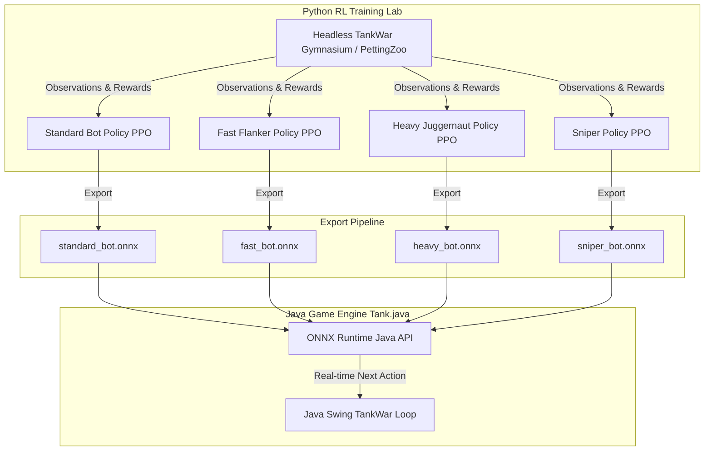
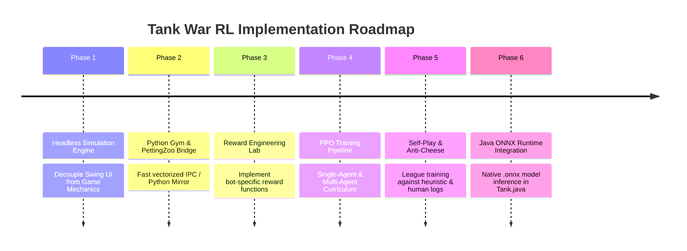

# 🧠 Reinforcement Learning (RL) Multi-Bot Training Roadmap

> **Project**: 2D Tank War (Java Swing Engine)  
> **Target**: Autonomous Bot AI with Distinct Personalities & Behavioral Rules via Reinforcement Learning (PPO / MAPPO)  
> **Bridge Strategy**: Python Gym / PettingZoo Training Loop ➔ ONNX Export ➔ Java ONNX Runtime Inference  

---

## 📑 Table of Contents
1. [Executive Vision & Architecture](#1-executive-vision--architecture)
2. [Bot Archetypes & Distinct Behavioral Profiles](#2-bot-archetypes--distinct-behavioral-profiles)
3. [Observation & Action Space Formulation](#3-observation--action-space-formulation)
4. [Mathematical Reward Engineering by Bot Archetype](#4-mathematical-reward-engineering-by-bot-archetype)
5. [The 6-Phase Implementation Roadmap](#5-the-6-phase-implementation-roadmap)
6. [Bridge Architecture: Training in Python & Inference in Java](#6-bridge-architecture-training-in-python--inference-in-java)
7. [Reference Code Templates](#7-reference-code-templates)
8. [Risks, Gotchas & Mitigation Strategies](#8-risks-gotchas--mitigation-strategies)
9. [Milestone Checklist](#9-milestone-checklist)

---

## 1. Executive Vision & Architecture

In the classic Java Tank War game, bot logic currently relies on heuristic state machines (`AIState.WANDERING`, `AIState.HUNTING`, and basic scent tracking). While functional, this leads to predictable pathing and mechanical exploits.

The goal of this roadmap is to replace rule-based logic with **Deep Reinforcement Learning (DRL)** agents trained under **differentiated reward profiles and behavioral constraints**. Each bot will develop a distinct "personality" and tactical doctrine:



---

## 2. Bot Archetypes & Distinct Behavioral Profiles

To prevent all bots from converging to the exact same optimal policy (e.g., standard rushing), each bot archetype is assigned a dedicated **doctrine, behavioral rule set, and observation specialization**:

| Archetype | In-Game Unit | Speed | HP | Tactical Doctrine | Core Learned Behaviors |
|---|---|:---:|:---:|---|---|
| **The Tactical Skirmisher** | `Bot` (Standard) | 2 px/tick | 1 | Balanced combat, cover-to-cover navigation | Keeps medium distance, shoots when aligned, takes cover behind bricks when player aims. |
| **The Predator / Flanker** | `BotFast` | 3 px/tick | 1 | Hit-and-run, high mobility, blind-spot ambushes | Avoids frontal line-of-sight; circles around player using high speed; pounces from flanks. |
| **The Juggernaut** | `BotHeavy` | 1 px/tick | 3 | Area denial, frontal assault, cover destruction | Marches directly into choke points; systematically blasts through brick walls; corners the player. |
| **The Sniper / Ghost** | `BotSniper` *(New)* | 2 px/tick | 1 | Long-range trigger discipline, stealth | Maintains maximum possible distance; conceals behind steel corners; shoots only on 100% clear shots. |
| **The Base Guardian** | `BotDefender` *(New)* | 2 px/tick | 2 | Defensive zoning & patrol | Holds defensive radius around base/spawn; intercepts incoming missiles; shields wounded allies. |

---

## 3. Observation & Action Space Formulation

### 3.1 Observation Space
Each bot receives a normalized local + global tensor representation $O \in \mathbb{R}^{C \times 15 \times 15}$ combined with a vector of scalar telemetry:

#### A. Spatial Grid Tensor ($7 \times 15 \times 15$ channels)
1. **Channel 0 (Walls)**: Destructible brick walls ($1.0$ = intact, $0.0$ = destroyed/empty).
2. **Channel 1 (Steel)**: Indestructible steel barriers ($1.0$ = wall, $0.0$ = empty).
3. **Channel 2 (Self Position & Facing)**: $1.0$ at bot cell, with orientation encoded in value $(0.25=\text{UP}, 0.5=\text{DOWN}, 0.75=\text{LEFT}, 1.0=\text{RIGHT})$.
4. **Channel 3 (Player Tank)**: $1.0$ at player position with player facing direction.
5. **Channel 4 (Allied Bots)**: $1.0$ for friendly bot positions (prevents friendly crowding).
6. **Channel 5 (Player Missiles)**: Positions and directional velocities of active player missiles.
7. **Channel 6 (Bot Missiles)**: Positions of active friendly missiles.

#### B. Direct Scalar Telemetry Vector ($\mathbb{R}^{12}$)
- `self_hp_normalized`: Bot health / max health ($[0.0, 1.0]$).
- `player_hp_normalized`: Player health / max health.
- `distance_to_player`: Euclidean distance normalized by board diagonal ($\sqrt{15^2 + 15^2}$).
- `has_clear_line_of_sight`: Boolean ($1.0$ or $0.0$).
- `player_aiming_at_self`: Boolean ($1.0$ if player is aligned and facing bot).
- `shoot_cooldown_remaining`: Normalized cooldown timer ($[0.0, 1.0]$).
- `nearest_missile_threat_distance`: Distance to closest incoming projectile.
- `nearest_cover_distance`: Distance to nearest brick/steel barrier.
- `current_lane_alignment`: X and Y modular grid alignment offsets.
- `recent_damage_taken`: Flag indicating damage in last $N$ frames.

### 3.2 Action Space
Discrete action space of size 6:
- `0`: Move Up
- `1`: Move Down
- `2`: Move Left
- `3`: Move Right
- `4`: Stay / Hold Position
- `5`: Fire Missile

*(Optional: Multi-Discrete Action Space `[MoveDir(5), Fire(2)]` allowing simultaneous movement and shooting).*

---

## 4. Mathematical Reward Engineering by Bot Archetype

The key to unlocking distinct behaviors is **reward shaping**. Below are the exact reward equations for each bot archetype:

### 4.1 Standard Bot (The Balanced Skirmisher)
$$R_{\text{standard}} = r_{\text{hit\_player}} + r_{\text{destroy\_player}} + r_{\text{dodge}} - r_{\text{hit\_taken}} - r_{\text{time\_penalty}} + r_{\text{los}}$$

- **Hit Player**: $+30.0$
- **Kill Player**: $+100.0$
- **Hit Taken**: $-50.0$
- **Death**: $-100.0$
- **Line of Sight Bonus**: $+0.2$ per step while having clear LoS to player.
- **Dodge Penalty/Bonus**: $+5.0$ for stepping out of a missile path.
- **Time/Step Penalty**: $-0.02$ (encourages task completion without stalling).

---

### 4.2 Fast Bot (The Flanker / Predator)
The Fast Bot is incentivized to flank from blind spots and punished for charging directly into the player's line of fire.

$$R_{\text{fast}} = R_{\text{standard}} + r_{\text{flank\_bonus}} + r_{\text{hit\_and\_run}} - r_{\text{frontal\_exposure}} - r_{\text{idle}}$$

$$\begin{aligned}
r_{\text{flank\_bonus}} &= 
\begin{cases} 
+1.5 & \text{if bot has LoS AND player is NOT facing the bot} \\
0.0 & \text{otherwise}
\end{cases} \\
r_{\text{frontal\_exposure}} &= 
\begin{cases} 
-2.0 & \text{if bot is within player LoS and player is facing bot} \\
0.0 & \text{otherwise}
\end{cases} \\
r_{\text{hit\_and\_run}} &= +10.0 \quad \text{for retreating behind cover immediately after firing} \\
r_{\text{speed\_bonus}} &= +0.05 \quad \text{for maintaining high movement velocity} \\
r_{\text{idle}} &= -0.1 \quad \text{for remaining stationary (Action 4)}
\end{aligned}$$

**Emergent Behavior**: Fast Bot circles around corridors, avoids face-to-face shootouts, and strikes when player is turned away.

---

### 4.3 Heavy Bot (The Juggernaut / Bulldozer)
The Heavy Bot has 3 HP and slow speed. It is incentivized to break obstacles, march inexorably toward the player, and corner targets.

$$R_{\text{heavy}} = R_{\text{standard}} + r_{\text{brick\_breach}} + r_{\text{cornering}} + r_{\text{pressure}} - r_{\text{retreat}}$$

$$\begin{aligned}
r_{\text{brick\_breach}} &= +3.0 \quad \text{for destroying brick walls that block the path to player} \\
r_{\text{pressure}} &= +0.5 \times (1.0 - \text{normalized\_dist\_to\_player}) \quad \text{(constant forward push)} \\
r_{\text{cornering}} &= +15.0 \quad \text{if player is trapped with $\le 1$ valid exit move} \\
r_{\text{tanking\_hit}} &= -5.0 \quad \text{(low penalty for taking hits, compared to -50 on Standard Bot)} \\
r_{\text{retreat}} &= -1.0 \quad \text{for moving away from player when HP} \ge 2
\end{aligned}$$

**Emergent Behavior**: Heavy Bot plows through brick structures, corners player in cul-de-sacs, and acts as an inescapable barrier.

---

### 4.4 Sniper Bot (The Ambush Specialist)
The Sniper Bot relies on range and concealment, firing high-probability shots.

$$R_{\text{sniper}} = R_{\text{standard}} + r_{\text{distance\_retention}} + r_{\text{accuracy}} - r_{\text{wasteful\_shot}} - r_{\text{proximity}}$$

$$\begin{aligned}
r_{\text{distance\_retention}} &= +0.8 \quad \text{if distance to player} \ge 8 \text{ tiles with LoS} \\
r_{\text{proximity}} &= -2.0 \quad \text{if distance to player} < 4 \text{ tiles} \\
r_{\text{accuracy}} &= +40.0 \quad \text{for hit with missile} \\
r_{\text{wasteful\_shot}} &= -5.0 \quad \text{for shooting when LoS is blocked by steel or outside grid line} \\
r_{\text{stealth\_positioning}} &= +0.3 \quad \text{for staying adjacent to steel corner with view on corridor}
\end{aligned}$$

**Emergent Behavior**: Sniper Bot retreats when player comes close, camps corridors, and holds fire until player enters crosshairs.

---

### 4.5 Swarm / Cooperative Multi-Agent Bonus
When multiple bots are active simultaneously:
$$r_{\text{cooperation}} = +10.0 \times \text{crossfire\_angle} - 5.0 \times \text{clustering\_penalty}$$
- **Crossfire Angle**: High reward if two bots approach player from perpendicular directions ($90^\circ$ pincer attack).
- **Clustering Penalty**: Heavy negative penalty if bots occupy adjacent tiles, preventing traffic jams.

---

## 5. The 6-Phase Implementation Roadmap



---

### Phase 1: Decoupling & Headless Simulation Engine (Weeks 1-2)
* **Objective**: Decouple the game model from `java.awt.Graphics` and `javax.swing.Timer` so the engine can run thousands of simulation steps per second.
* **Tasks**:
  1. Refactor `Tank.java` to extract `TankSimulationState.java` containing only coordinates, grid state, missile physics, and collision logic.
  2. Implement `step(int[] botActions, int playerAction)` method returning `(nextState, rewards, done, info)`.
  3. Create a benchmark test: verify headless simulator executes $\ge 50,000$ steps/sec.
* **Deliverable**: `HeadlessTankEngine.java` without any AWT/Swing dependencies.

---

### Phase 2: Python Gym / PettingZoo Environment (Weeks 3-4)
* **Objective**: Expose the simulation engine to Python RL libraries (`Gymnasium`, `PettingZoo`, `Stable-Baselines3`, `CleanRL`).
* **Architecture Choice**:
  - **Option A (High Throughput)**: Re-implement the grid physics in a lightweight Python/NumPy/Numba module (`tankwar_env.py`).
  - **Option B (Zero Divergence)**: Run `HeadlessTankEngine.java` as a subprocess communicating via Py4J, Unix Domain Sockets, or shared memory.
  - *Recommendation*: **Option A** for 20x faster training, cross-validated against Java tests to guarantee physics parity.
* **Tasks**:
  1. Build `TankWarEnv(gymnasium.Env)` conforming to standard Gymnasium API.
  2. Implement PettingZoo `ParallelEnv` for multi-agent bot vs. player training.
  3. Build a visual debugger in Python with Pygame to visually verify bot observation channels.
* **Deliverable**: `gym_tankwar/` Python package with automated test suite.

---

### Phase 3: Bot-Specific Reward Engineering & Policy Setup (Weeks 5-6)
* **Objective**: Implement differentiated reward functions and neural network policy backbones.
* **Tasks**:
  1. Code custom `RewardCalculator` classes for `StandardBot`, `FastBot`, `HeavyBot`, and `SniperBot`.
  2. Design neural network architecture:
     - **CNN Feature Extractor**: 2-layer Convolutional network for the $7 \times 15 \times 15$ grid.
     - **MLP Head**: Fully connected layers processing scalar telemetry (HP, LoS, Cooldowns).
     - **Fusion Layer**: Concatenates CNN and MLP embeddings ➔ Actor & Critic heads.
  3. Verify reward gradient: Run short 100k step diagnostic runs to ensure bots do not get trapped in local minima (e.g., spinning in place or wall-hugging).
* **Deliverable**: Bot policy networks with isolated policy heads.

---

### Phase 4: Training Pipeline & Curriculum Learning (Weeks 7-9)
* **Objective**: Train master policies using Proximal Policy Optimization (PPO).
* **Curriculum Schedule**:
  - **Stage 1 (Baby Steps - 1M steps)**: Static player dummy, open arena without brick walls. Learn to aim and shoot.
  - **Stage 2 (Obstacle Mastery - 3M steps)**: Standard 15x15 brick maps, player uses simple heuristic A* pathfinding.
  - **Stage 3 (Archetype Specialization - 5M steps)**: Activate differentiated reward profiles. Fast bot learns flanking; Heavy bot learns wall demolition.
  - **Stage 4 (Multi-Bot Combat - 10M steps)**: 3 vs 1 scenarios (1 Standard, 1 Fast, 1 Heavy vs. Expert Player).
* **Hyperparameter Baseline (PPO)**:
  - Learning Rate: $2.5 \times 10^{-4}$ with linear decay
  - Rollout Steps: $2048$ per environment across $16$ parallel envs ($32,768$ batch size)
  - Discount Factor $\gamma$: $0.99$
  - GAE $\lambda$: $0.95$
  - Entropy Coefficient: $0.01$ (higher for Fast Bot to encourage exploration)
* **Deliverable**: Trained PyTorch weights (`.pt`) achieving $>85\%$ win rate against Level 1-5 maps.

---

### Phase 5: Self-Play & Anti-Cheese Hardening (Weeks 10-11)
* **Objective**: Prevent bot policies from learning "gamey" exploits that human players can easily counter.
* **Tasks**:
  1. Implement **Fictitious Self-Play (FSP)**: Bots train against past checkpoints of themselves and past player policies.
  2. Implement human trajectory replay: Seed training with recorded human keystrokes from `Tank.java`.
  3. Stress-test edge cases: corridor trapping, corner camping, missile evasion limits.
* **Deliverable**: Robust, human-like policy checkpoints resilient to repetitive tactics.

---

### Phase 6: ONNX Export & Native Java Integration (Weeks 12-13)
* **Objective**: Run inference directly inside the existing Java Swing `Tank.java` game at 60 FPS with zero latency lag.
* **Tasks**:
  1. Export trained PyTorch policies to ONNX format with dynamic batching:
     ```python
     torch.onnx.export(policy_net, dummy_input, "fast_bot.onnx", opset_version=14)
     ```
  2. Add `com.microsoft.onnxruntime:onnxruntime` dependency to the Java project (`lib/` or Maven).
  3. Implement `RLBotController.java` inside `src/`:
     - Extracts the $7 \times 15 \times 15$ tensor from `Tank` game state.
     - Runs `session.run()` in under $1.2\text{ ms}$.
     - Translates discrete action output into `tank.setDirection()` and `tank.shoot()`.
  4. Add an in-game toggle: switch between Legacy Heuristic AI and RL Agent AI in the UI sidebar.
* **Deliverable**: Seamless native Java integration running offline without external Python dependencies.

---

## 6. Bridge Architecture: Training in Python & Inference in Java

```text
TRAINING PHASE (High Speed, Parallelized)
┌────────────────────────────────────────────────────────┐
│ Python 3.10+ (Stable-Baselines3 / Ray RLLib / PyTorch) │
│ - 16 to 32 Parallel Vectorized Environments            │
│ - GPU Acceleration (CUDA / MPS)                        │
│ - Thousands of Episodes per Minute                     │
└──────────────────────────┬─────────────────────────────┘
                           │ Exports (.onnx)
                           ▼
RUNTIME DEPLOYMENT (Clean, Lightweight, Standalone)
┌────────────────────────────────────────────────────────┐
│ Java 17+ Game Runtime (Tank.java + Swing HUD)          │
│                                                        │
│   ┌────────────────────────────────────────────────┐   │
│   │ Tank.java Game Loop (60 FPS / 16ms tick)       │   │
│   │   │                                            │   │
│   │   ├──> Extract Observation Tensor              │   │
│   │   │                                            │   │
│   │   ├──> Microsoft ONNX Runtime Java API         │   │
│   │   │    (fast_bot.onnx / heavy_bot.onnx)        │   │
│   │   │                                            │   │
│   │   └──> Execute Action (UP, DOWN, SHOOT, etc.)  │   │
│   └────────────────────────────────────────────────┘   │
└────────────────────────────────────────────────────────┘
```

**Benefits of this Architecture:**
1. **Zero Python Dependency at Runtime**: End users do not need Python, PyTorch, or CUDA installed to play the game; the Java game runs standalone with a single lightweight jar (`onnxruntime.jar`).
2. **Deterministic & Blazing Fast**: Model inference on CPU takes $<1.5\text{ ms}$, leaving over $14\text{ ms}$ for Java Swing rendering per frame.
3. **Moddability**: New models can be dropped into the `models/` directory without recompiling Java source code.

---

## 7. Reference Code Templates

### 7.1 Python Gymnasium Environment Skeleton (`rl/tankwar_env.py`)

```python
import gymnasium as gym
from gymnasium import spaces
import numpy as np

class TankWarEnv(gym.Env):
    metadata = {"render_modes": ["human", "rgb_array"], "render_fps": 30}

    def __init__(self, bot_type="standard", grid_size=15):
        super().__init__()
        self.grid_size = grid_size
        self.bot_type = bot_type  # 'standard', 'fast', 'heavy', 'sniper'

        # Action: 0:Up, 1:Down, 2:Left, 3:Right, 4:Stay, 5:Shoot
        self.action_space = spaces.Discrete(6)

        # Observation: 7-channel 15x15 grid + 12-dim telemetry vector
        self.observation_space = spaces.Dict({
            "grid": spaces.Box(low=0.0, high=1.0, shape=(7, grid_size, grid_size), dtype=np.float32),
            "telemetry": spaces.Box(low=0.0, high=1.0, shape=(12,), dtype=np.float32)
        })

    def reset(self, seed=None, options=None):
        super().reset(seed=seed)
        self._init_game_state()
        return self._get_obs(), {}

    def step(self, action):
        self._apply_action(action)
        self._update_physics()

        reward = self._calculate_reward(self.bot_type, action)
        terminated = self._is_terminal()
        truncated = self.step_count >= 1000

        return self._get_obs(), reward, terminated, truncated, {}

    def _calculate_reward(self, bot_type, action):
        reward = -0.01  # Base step penalty
        
        # Archetype-specific shaping
        if bot_type == "fast":
            if self._is_flanking():
                reward += 1.5
            if self._is_facing_player_barrel():
                reward -= 2.0
        elif bot_type == "heavy":
            if self._destroyed_brick_this_step():
                reward += 3.0
            reward += 0.5 * (1.0 - self._player_dist_norm())
        elif bot_type == "sniper":
            if self._player_dist_norm() > 0.6 and self._has_los():
                reward += 0.8
            if action == 5 and not self._has_los():
                reward -= 5.0  # Trigger discipline
                
        if self._player_killed():
            reward += 100.0
        if self._bot_died():
            reward -= 100.0
            
        return float(reward)
```

---

### 7.2 Training Script with Stable-Baselines3 (`rl/train.py`)

```python
import os
from stable_baselines3 import PPO
from stable_baselines3.common.vec_env import SubprocVecEnv
from tankwar_env import TankWarEnv

def make_env(bot_type, rank):
    def _init():
        return TankWarEnv(bot_type=bot_type)
    return _init

def train_archetype(bot_type="fast", total_timesteps=5_000_000):
    num_envs = 8
    env = SubprocVecEnv([make_env(bot_type, i) for i in range(num_envs)])

    policy_kwargs = dict(
        net_arch=dict(pi=[128, 128], vf=[128, 128])
    )

    model = PPO(
        "MultiInputPolicy",
        env,
        learning_rate=2.5e-4,
        n_steps=2048,
        batch_size=64,
        gamma=0.99,
        gae_lambda=0.95,
        ent_coef=0.01 if bot_type != "fast" else 0.02,
        policy_kwargs=policy_kwargs,
        verbose=1,
        tensorboard_log=f"./logs/{bot_type}_bot/"
    )

    print(f"[*] Training {bot_type} bot for {total_timesteps} steps...")
    model.learn(total_timesteps=total_timesteps)
    model.save(f"weights/{bot_type}_bot_ppo")
    print(f"[+] Saved model to weights/{bot_type}_bot_ppo.zip")

if __name__ == "__main__":
    for archetype in ["standard", "fast", "heavy", "sniper"]:
        train_archetype(archetype, total_timesteps=3_000_000)
```

---

### 7.3 Java ONNX Runtime Integration Blueprint (`src/RLBotController.java`)

```java
import ai.onnxruntime.*;
import java.nio.FloatBuffer;
import java.util.*;

public class RLBotController {
    private OrtEnvironment env;
    private OrtSession session;

    public RLBotController(String modelPath) {
        try {
            this.env = OrtEnvironment.getEnvironment();
            this.session = env.createSession(modelPath, new OrtSession.SessionOptions());
            System.out.println("[RLBotController] Loaded ONNX model from: " + modelPath);
        } catch (OrtException e) {
            e.printStackTrace();
        }
    }

    /**
     * Executes neural inference to predict the next best discrete action.
     * @param gridTensor 7x15x15 normalized game grid representation
     * @param telemetry 12-element scalar status vector
     * @return Action index (0: UP, 1: DOWN, 2: LEFT, 3: RIGHT, 4: STAY, 5: SHOOT)
     */
    public int predictAction(float[][][] gridTensor, float[] telemetry) {
        if (session == null) return 4; // Default STAY if uninitialized

        try {
            long[] gridShape = new long[]{1, 7, 15, 15};
            long[] telemetryShape = new long[]{1, 12};

            FloatBuffer gridBuffer = flattenGrid(gridTensor);
            FloatBuffer telemetryBuffer = FloatBuffer.wrap(telemetry);

            OnnxTensor gridOnnx = OnnxTensor.createTensor(env, gridBuffer, gridShape);
            OnnxTensor telemetryOnnx = OnnxTensor.createTensor(env, telemetryBuffer, telemetryShape);

            Map<String, OnnxTensor> inputs = new HashMap<>();
            inputs.put("grid", gridOnnx);
            inputs.put("telemetry", telemetryOnnx);

            try (OrtSession.Result results = session.run(inputs)) {
                float[][] logits = (float[][]) results.get(0).getValue();
                return argmax(logits[0]);
            }
        } catch (OrtException e) {
            e.printStackTrace();
            return 4;
        }
    }

    private int argmax(float[] array) {
        int bestIdx = 0;
        float maxVal = array[0];
        for (int i = 1; i < array.length; i++) {
            if (array[i] > maxVal) {
                maxVal = array[i];
                bestIdx = i;
            }
        }
        return bestIdx;
    }

    private FloatBuffer flattenGrid(float[][][] grid) {
        FloatBuffer buffer = FloatBuffer.allocate(7 * 15 * 15);
        for (int c = 0; c < 7; c++) {
            for (int r = 0; r < 15; r++) {
                for (int col = 0; col < 15; col++) {
                    buffer.put(grid[c][r][col]);
                }
            }
        }
        buffer.flip();
        return buffer;
    }
}
```

---

## 8. Risks, Gotchas & Mitigation Strategies

| Risk / Pitfall | Impact | Detection / Symptom | Mitigation Strategy |
|---|---|---|---|
| **Sparse Reward Trap** | High | Bots spin in circles; never learn to hit the player. | Use dense curriculum: reward line-of-sight alignment and bullet proximity before full kills. |
| **Grid Boundary Snapping** | Medium | Bot requests move that violates grid alignment. | Constrain action space with an **Action Mask** (`invalid_action_masking` in PPO) blocking moves into walls. |
| **Friendly Fire Carnage** | High | Bots kill each other while rushing player. | Add $-25.0$ penalty for shooting when allied bot is in line-of-fire corridor. |
| **Policy Exploitation (Cheese)** | High | Bot discovers an unbreakable loop (e.g. corner camping). | Incorporate Domain Randomization (varying spawn points, wall hardness, player reaction speed). |
| **Java Swing Latency Spike** | Low | Frame drops during inference. | Run ONNX inference asynchronously on a dedicated worker thread or batch multiple bot requests into a single tensor. |

---

## 9. Milestone Checklist

- [ ] **M1**: Extract headless simulation core from `Tank.java`
- [ ] **M2**: Benchmark headless simulation at $\ge 50\text{k steps/sec}$
- [ ] **M3**: Build Gym environment and verify observation visualizer
- [ ] **M4**: Implement discrete action masking for wall collisions
- [ ] **M5**: Verify Standard Bot convergence (baseline PPO)
- [ ] **M6**: Implement Flanker reward function and verify blind-spot attacks
- [ ] **M7**: Implement Juggernaut reward function and verify brick wall destruction
- [ ] **M8**: Implement Sniper reward function and verify trigger discipline
- [ ] **M9**: Export policies to `.onnx` and validate equivalence against PyTorch outputs
- [ ] **M10**: Add ONNX Runtime to Java `lib/` and wire `RLBotController` into `Tank.java`
- [ ] **M11**: Add in-game HUD toggle for `[AI Mode: Heuristic | RL DeepNet]`
